# Underworld Editor (Avalonia)

**Open the Stygian Abyss and change anything in it.** This is a level editor for **Ultima
Underworld I** and **II** that runs on Windows, Linux and macOS. It shows every level in
3D as the game draws it, and edits tiles, objects, traps, conversations, strings, the
player, pictures, sounds and music. It can test your changes in the real game, pack them
into mods, and shuffle the whole world into a randomizer run that stays beatable.

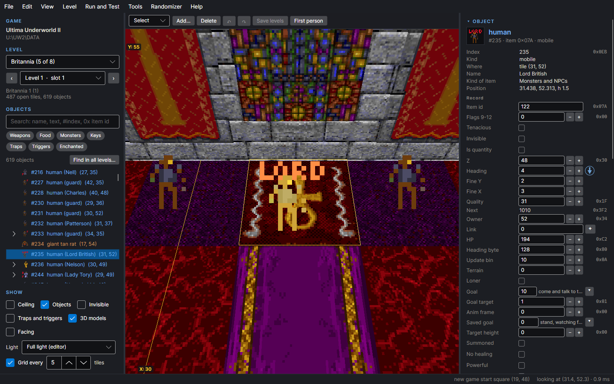

**Get it:** ready-made builds for Windows, Linux and macOS are on the
[Releases page](https://github.com/KarlClinckspoor/UltimaUnderworldEditorAvalonia/releases).
Point it at your own copy of the game and go. With GOG's current release, open its
`game.gog` (**File ▸ Open GOG's game.gog…**): the editor copies both games out of the CD image
and edits the copy, leaving the GOG install as it is.

**Why it is worth a look:**
- **It reads the game the way the game reads itself.** Every file format and rule comes from
  [underworld-exhumed](https://github.com/abedegno/underworld-exhumed), the reconstructed
  source of both games, and the tooltips name the routine each field comes from.
- **It does not break your game.** Every file it writes keeps its previous version as a
  `.BKP` and its first version as a `.ORIG`. It runs the game's own consistency checks, and
  refuses files the game could not load. Unsaved work is kept in checkpoints and survives a crash.
- **Both games, one editor.** It edits UW1 and UW2, both the shipped data and saved games.
- **Proven on the real data.** Every shipped conversation and picture of both games, and the
  string and conversation archives, are read and written back to the same bytes in the tests.

## Contents

- [The 3D view](#the-3d-view)
- [Every field, explained](#every-field-explained)
- [Building levels](#building-levels)
- [Finding anything](#finding-anything)
- [Conversations](#conversations)
- [Game variables](#game-variables)
- [The player and the inventory](#the-player-and-the-inventory)
- [Pictures, animations and 3D models](#pictures-animations-and-3d-models)
- [Sound and music](#sound-and-music)
- [Keys, triggers and strings](#keys-triggers-and-strings)
- [Tables and new items](#tables-and-new-items)
- [The automap](#the-automap)
- [The randomizer](#the-randomizer)
- [Testing in the real game](#testing-in-the-real-game)
- [Mods, checkpoints and safety](#mods-checkpoints-and-safety)
- [Downloads](#downloads) · [Building and running](#building-and-running) · [Tests](#tests) · [Layout](#layout) · [License](#license)

## The 3D view

<table>
<tr>
<td>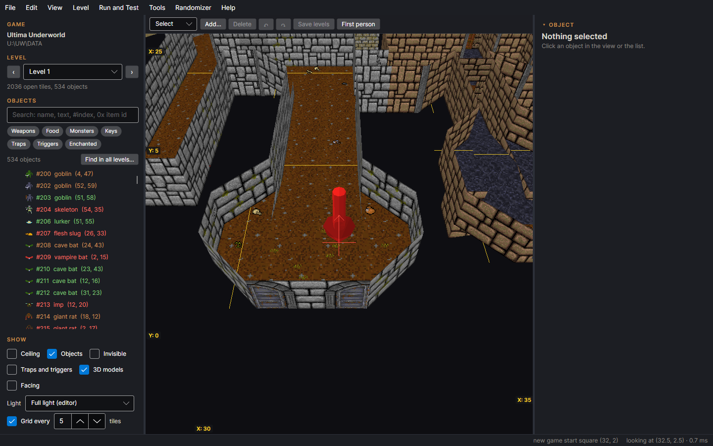</td>
<td>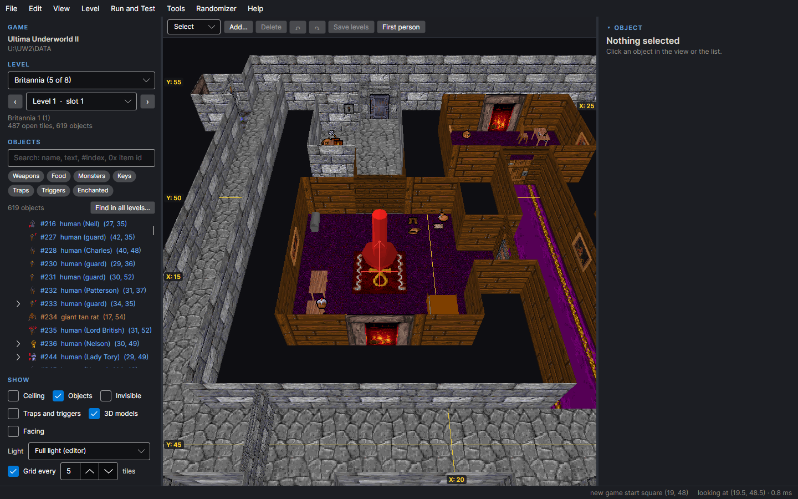</td>
</tr>
<tr>
<td>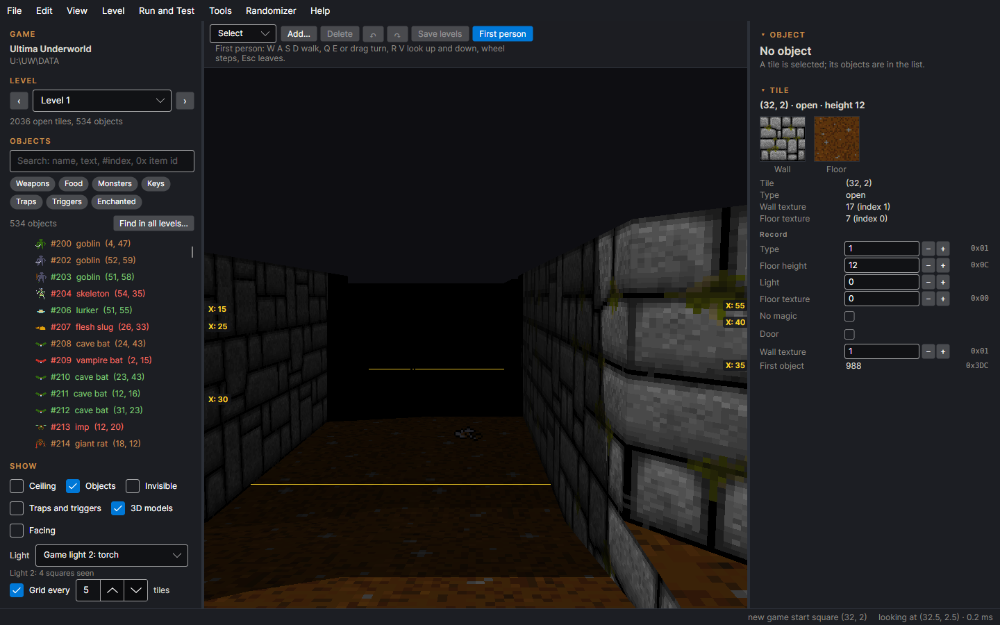</td>
<td>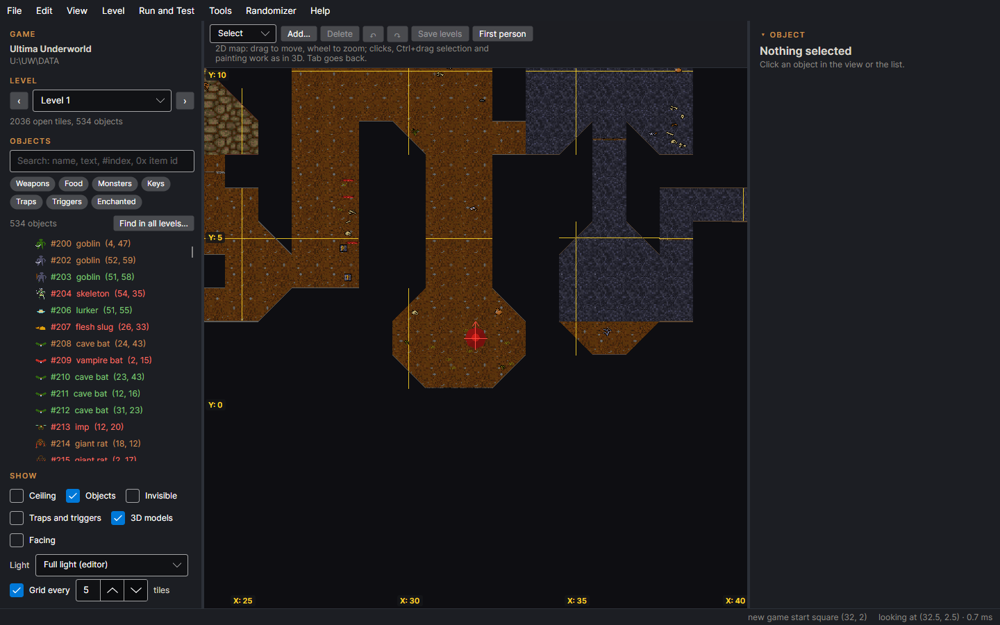</td>
</tr>
</table>

Fly over any level, or walk through it at eye height.
- **Drawn as the game draws it:** floors, walls, slopes and diagonal walls through the
  level's texture map, and the ceiling (G) seen only from below. Doors sit in their frames
  (open ones swung, the portcullis raised, the secret door in the wall), and levers and
  writings sit on their walls. Furniture, pillars and bridges are drawn as the 3D models built
  into the executable, and everything else as its picture facing the camera.
- **The game's own light:** full light, or any of its eight light levels, from no light and
  a candle up to a light sphere and Wizard Eye. Each square gets one of LIGHT.DAT's shading
  maps by its distance, as in the game.
- **First person** (P): W A S D walk, Q E or a drag turn, R V look up and down. Rock and
  floors more than two steps up stop you.
- **2D map** (Tab): the level straight down, exportable as a PNG.
- **Where things start:** the camera opens over the new-game start, read from `UW.EXE` /
  `UW2.EXE` and marked by a red arrow, or over the player in a saved game, marked by a green arrow.
- A labelled grid every N tiles (H), invisible objects and traps on request, and PgUp / PgDn
  to step through the levels. UW2's worlds and their slots are picked from a list.

## Every field, explained

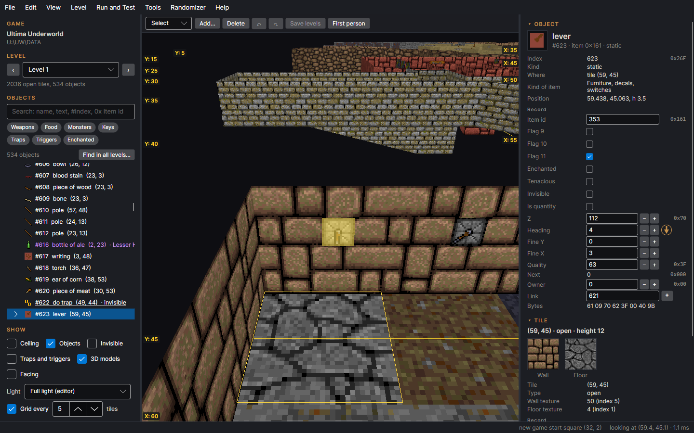

Click anything in the view or the object list and the properties panel shows **every field**
of its object and tile records, in decimal and hex.
- Each field's **tooltip says what it means and where it comes from** in the reconstructed
  game code. Fields whose meaning is only inferred are marked.
- **Type into any field**, decimal or `0x` hex. Small fields have − and + buttons, flags are
  checkboxes, the heading is an arrow, and the owner is picked from a list of races named by
  their creatures.
- Talking creatures show their name and unique items their plot name: "fighter (Corby)",
  "shiny sword (Caliburn, the Sword of Justice)". Enchanted objects show the enchantment, and
  names are coloured by attitude.
- Whatever is inside an object (contents, inventories, a trigger's trap, a door's lock)
  hangs under it in the list.

## Building levels

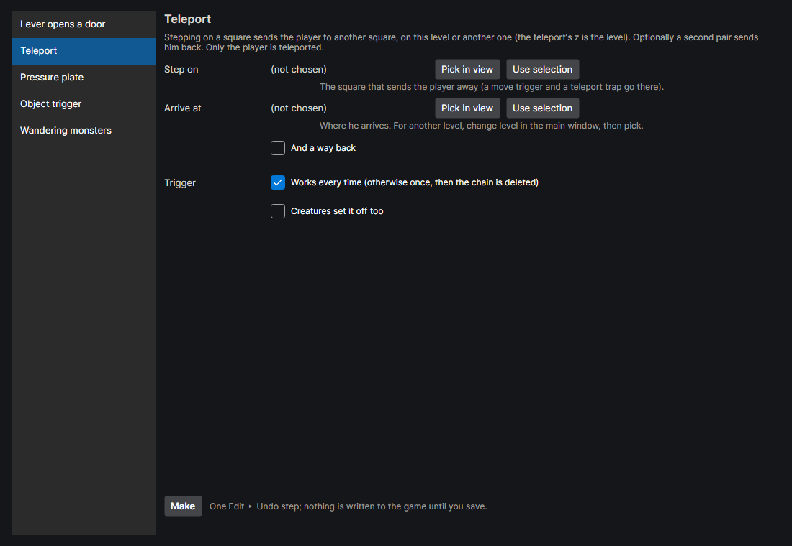

Each level keeps its own undo history (Ctrl+Z, Ctrl+Y, and Ctrl+H for the list of steps).
- **Paint** tiles: textures from the level's list (with thumbnails), tile types, floor
  heights, the light flag, or a whole template. **Fill** paints everything walkable from a
  square. **Ctrl+wheel** raises or lowers a floor and the objects on it.
- **Move** objects by clicking a square or dragging, to the eighth of a tile, or onto a
  container, creature or trigger to put them inside.
- **Add…** (Insert) shows the items as a tree, with a form that fits each kind: a weapon's
  enchantment (with what it really does), a wand's spell and charges, a book's text, a key's
  lock, a creature's hit points, attitude and conversation.
- **Copy, cut, paste and duplicate** objects with everything inside them, to any level of the
  same game.
- **Traps and triggers explained:** selecting one says what its kind does and what each
  field means, and a **red bullseye** marks the square it acts on: the target, a teleport's
  destination (even on another level), a delete trap's square.
- **Trap recipes** build the usual contraptions in one undo step: a lever that opens a door,
  teleports there and back, pressure plates, pick-up, use and look triggers that deal damage,
  show a message, set a variable, create an object or creature, open a door or remove
  something, and wandering-monster spawners.
- **Fixes** finds and repairs object-list and game-logic problems, the **Item cleaner**
  sweeps away debris and junk (never quest items, keys or texts), the **World check** finds
  locks no key opens, and **Check the object lists** runs the game's own `Obj_ListOkay`.
- **Move the start:** with the Move tool, click the red arrow and a square to patch the new-game
  start into the executable, or the green one to put a saved game's player on any square of any level.
- **Make this slot a level** and **Clear the level** create or empty levels; **Level
  textures** changes the textures a level uses.

## Finding anything

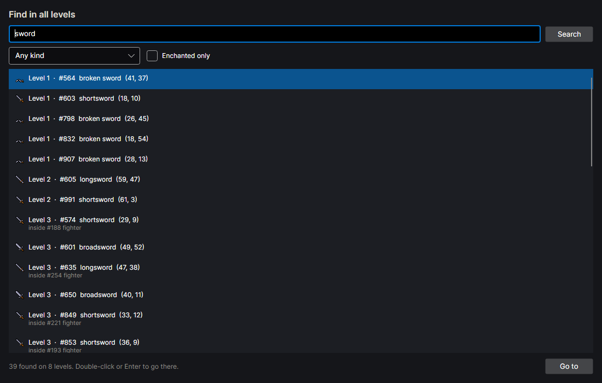

The search box matches item names, NPC names ("human (Lord British)"), the text of books,
scrolls, writings, gravestones and text traps, `#index` and `0x` item ids. Chips narrow it to
weapons, food, monsters, keys, traps, triggers or enchanted objects. **Find in all levels**
(Ctrl+Shift+F) searches the whole game; double-click a result to jump there.

## Conversations

<table>
<tr>
<td colspan="2">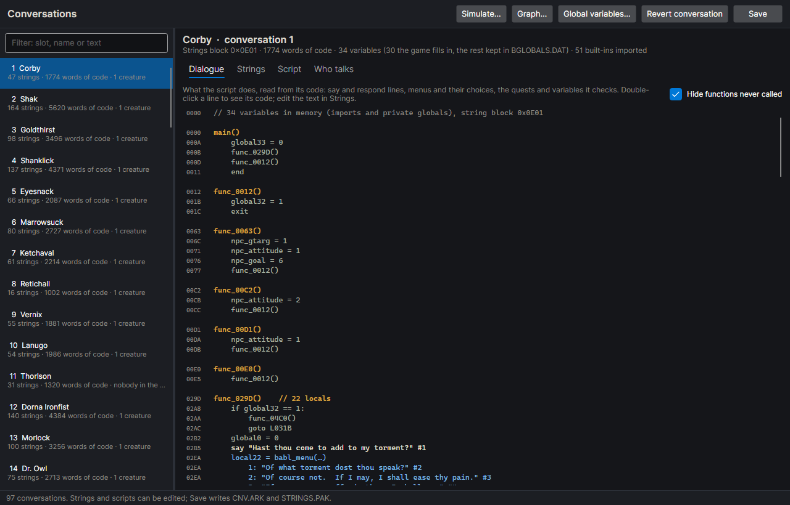</td>
</tr>
<tr>
<td>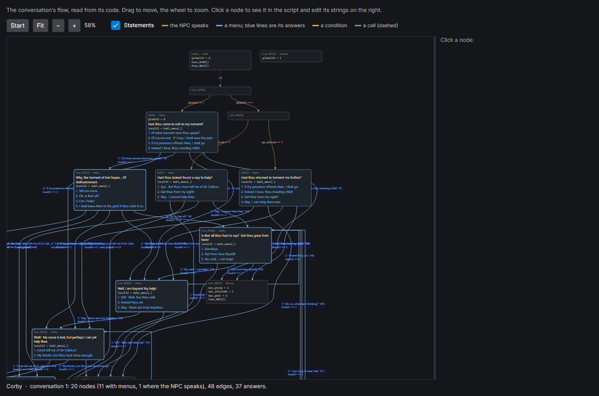</td>
<td>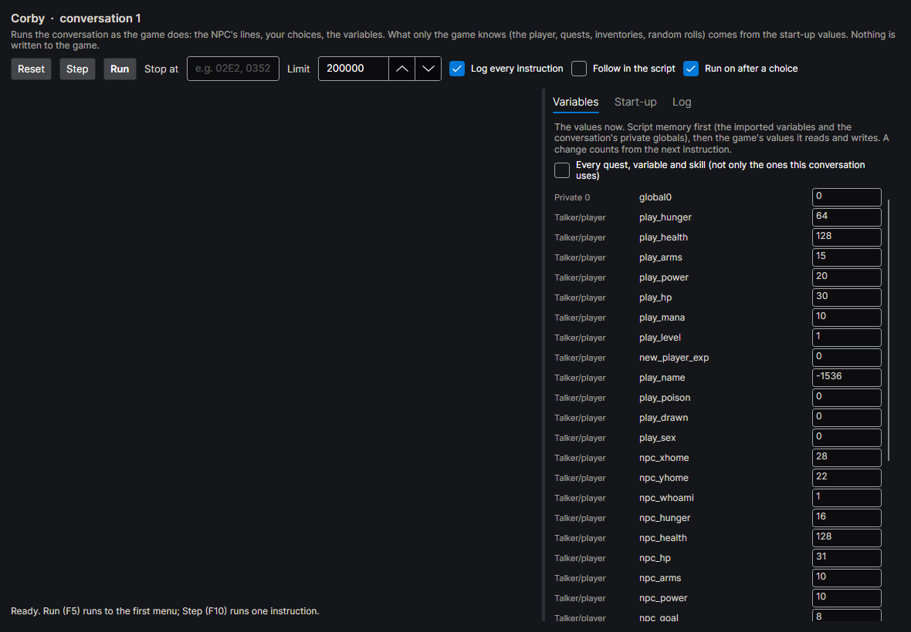</td>
</tr>
</table>

Read, change and run every conversation in CNV.ARK (Ctrl+Shift+C).
- **Dialogue:** the conversation as readable source, rebuilt from its code, and edited there:
  what the NPC says, each menu with its answers, the checks on quests and variables. Change a
  line or add a menu choice, and **Apply** (Ctrl+Enter) compiles it back into the
  conversation and its strings; unchanged functions keep their exact bytes. Mistakes are
  underlined as you type and listed, with colours, find, go to line, F2 rename and F12 to a
  function. **Simulate** runs the text as typed, and **Undo apply** puts an Apply back.
- **Names, not numbers:** functions, labels and variables carry names (from a names file
  shipped for each game, which follows a conversation you edit function by function), and
  F2 renames one everywhere. **Export names** saves your own names to share.
- **Strings:** the conversation's text, edited in place, each string showing where the
  script uses it.
- **Script:** the code as readable assembly, with labels, named imports and comments.
  **Apply** assembles it again, and a mistake is reported at its line. Every shipped
  conversation of both games disassembles and assembles back to the same bytes.
- **Who talks:** the creatures in the levels that use the conversation.
- **Graph:** the conversation's flow as nodes and edges, with editable strings.
- **Simulator:** run a conversation with its menus, the game's variables and a saved game's
  state, step by step.

Saving rewrites only the changed blocks of CNV.ARK and STRINGS.PAK (compressed again in UW2).

## Game variables

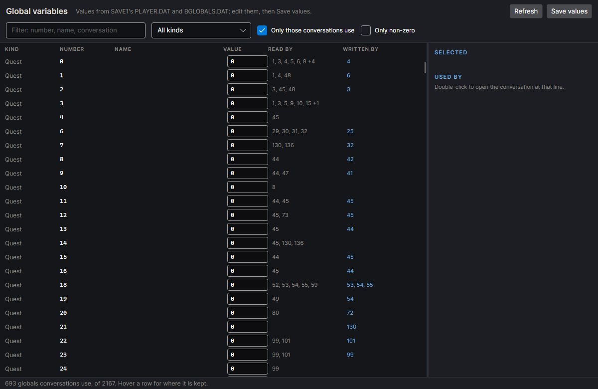

The global variables window (Ctrl+Shift+G) shows every piece of game state a conversation can
read or change: quest flags and
bytes, the variables traps share, UW2's X clocks, skills, the talker's and player's variables,
and each conversation's private globals. Each one lists the conversations that read and write
it; double-click to open the script at that line. With a saved game open, the values come from
its `PLAYER.DAT` and `BGLOBALS.DAT` and can be changed and saved.

## The player and the inventory

<table>
<tr>
<td>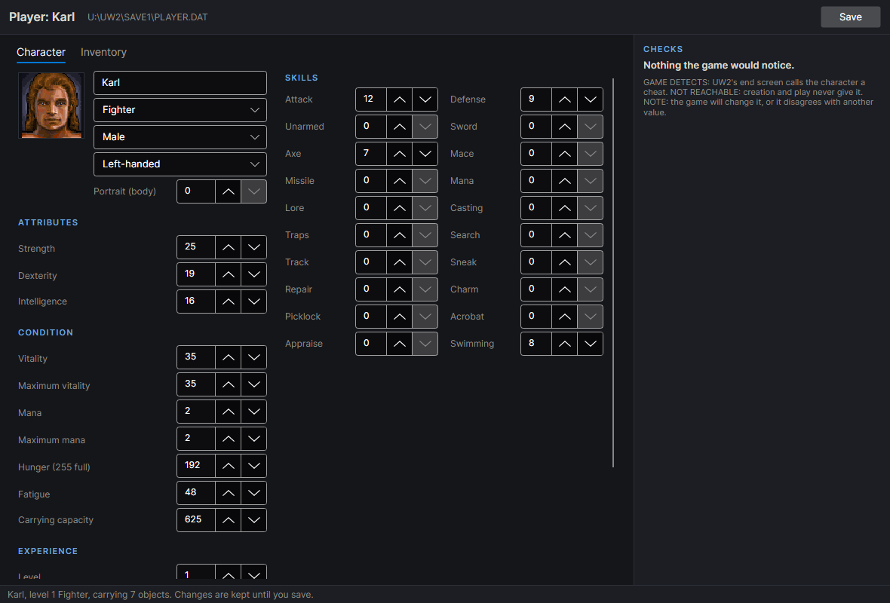</td>
<td>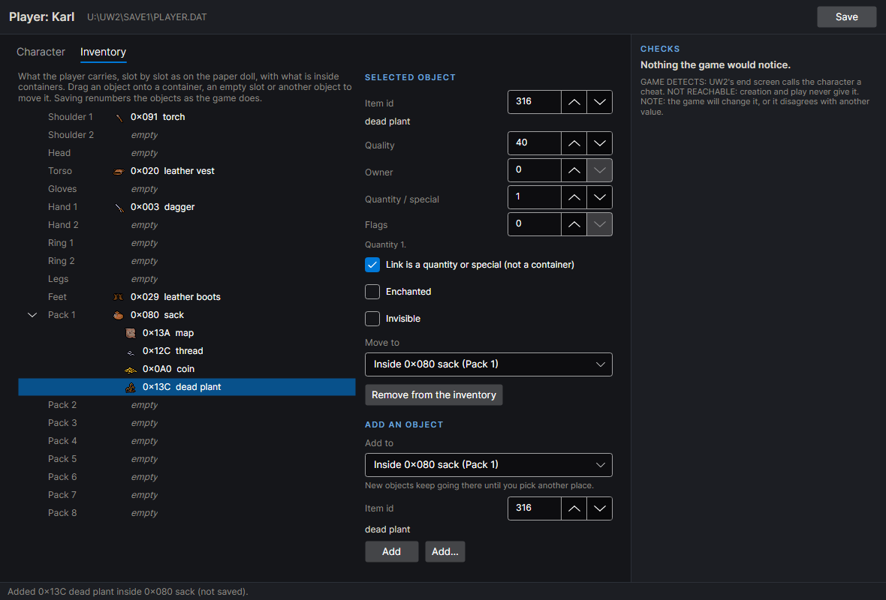</td>
</tr>
</table>

With a saved game open (Ctrl+Shift+P):
- **The character:** name, class, sex, hand, portrait, attributes, vitality, mana, hunger,
  fatigue, level, experience and the twenty skills.
- **Checks as you type:** what the game itself would notice (UW2 calls attributes above 64
  "CHEATED ON THEIR CHARACTER" on its end screen), values normal play never gives, and maxima
  that disagree with what the game computes, with a button to set them right.
- **The inventory, slot by slot** as on the paper doll: shoulders, head, torso, gloves, hands,
  rings, legs, feet, then the eight pack slots. Drag objects into containers or other slots,
  pick a bag once and add one item after another into it, and edit each object's fields.

## Pictures, animations and 3D models

<table>
<tr>
<td>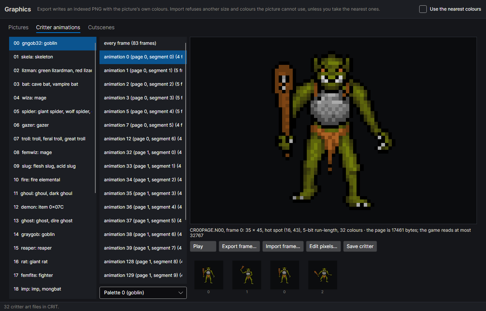</td>
<td>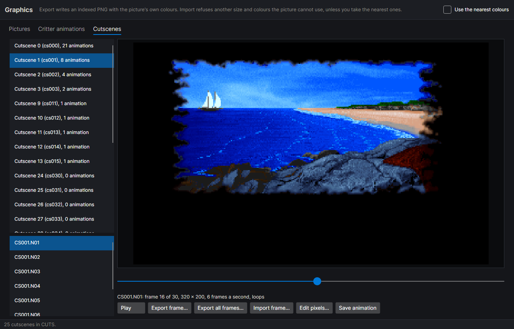</td>
</tr>
<tr>
<td>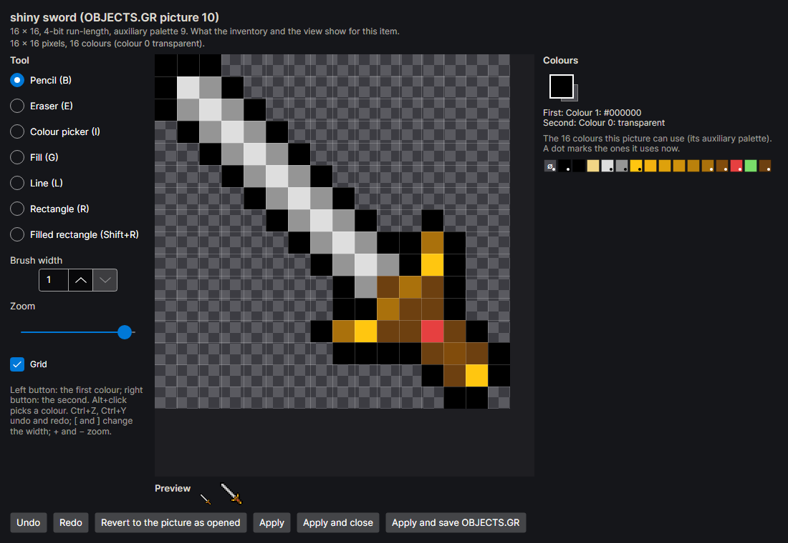</td>
<td>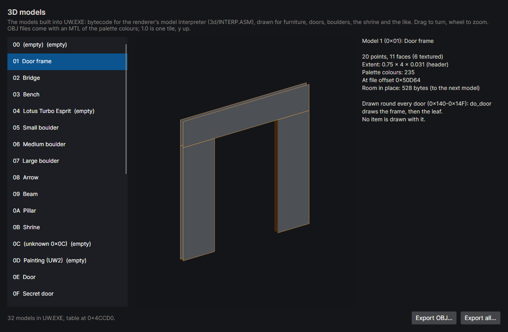</td>
</tr>
</table>

- **Graphics** (Ctrl+Shift+R): every `.GR`, `.TR` and `.BYT` picture, the critter animations
  (played or stepped through, in any auxiliary palette) and the cutscenes, playing at their
  own frame rate.
- **Export and import PNGs** that keep their palette indices. Imports are checked: the size,
  colours the picture cannot use (with the nearest ones offered), transparency in a solid
  picture, and files the game could not load are all refused. A replaced cutscene frame
  re-encodes only its own delta.
- **Fonts and accented letters:** edit the six fonts glyph by glyph (with "Make accented
  letter"), export and import them as PNG sheets or BDF, and export TrueType fonts to install.
  An accent table gives letters such as é, ç and ñ codes the game can draw. The strings
  editors show and take those letters, and STRINGS.PAK gets a new Huffman tree when it needs one.
  The game as shipped draws only a handful of spare codes, so a long accent table needs a
  changed executable: the editor warns in red when a table goes beyond them.
- **Pixel editor:** draw on any picture with its own colours: pencil, eraser, picker, fill,
  lines, rectangles and undo. The colours the game cycles (water, lava, fire) are marked and
  can be animated.
- **3D models** (Ctrl+Shift+O): the 32 models built into the executable, turned with the
  mouse, with their points, faces and colours, exported as Wavefront OBJ.

## Sound and music

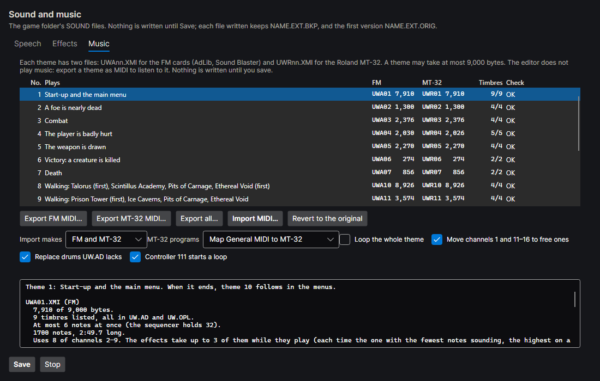

Play, export and replace the speech and sound effects from WAV files (converted and checked
against the games' limits), edit SOUNDS.DAT and add UW2 trap sounds. Export any music theme
as MIDI, and import MIDI files as new themes in both their FM and MT-32 versions.

## Keys, triggers and strings

<table>
<tr>
<td>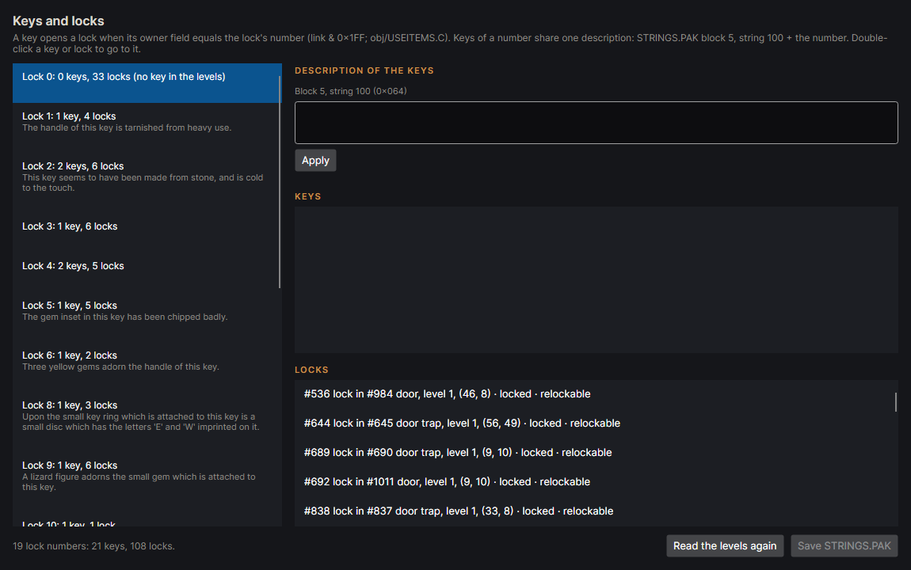</td>
<td>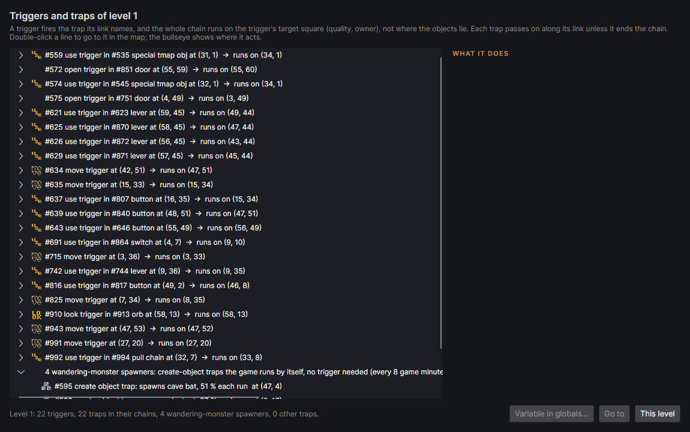</td>
</tr>
<tr>
<td colspan="2">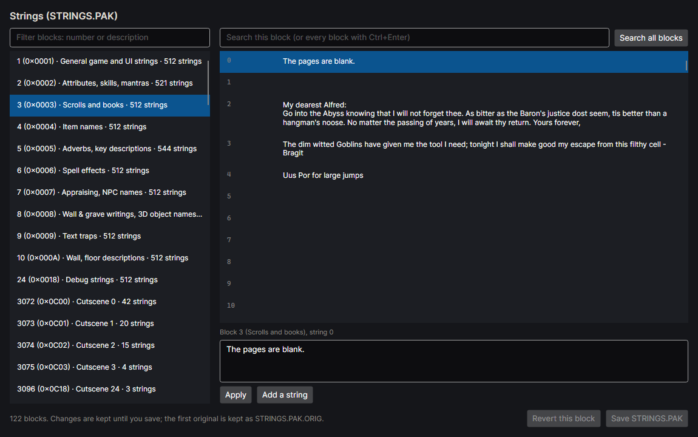</td>
</tr>
</table>

- **Keys and locks** (Ctrl+Shift+K): every lock number with its keys and locks across all
  levels, where each lies, whether it is locked, and the key's description to edit.
- **Triggers and traps** (Ctrl+Shift+T): every trigger of a level, the square its chain runs
  on, each trap in it, and the traps nothing reaches, each explained in a line.
- **Strings** (Ctrl+Shift+S): every block of STRINGS.PAK, searched in one block or all of
  them, edited and added to. Characters the file cannot hold are refused.

## Tables and new items

<table>
<tr>
<td>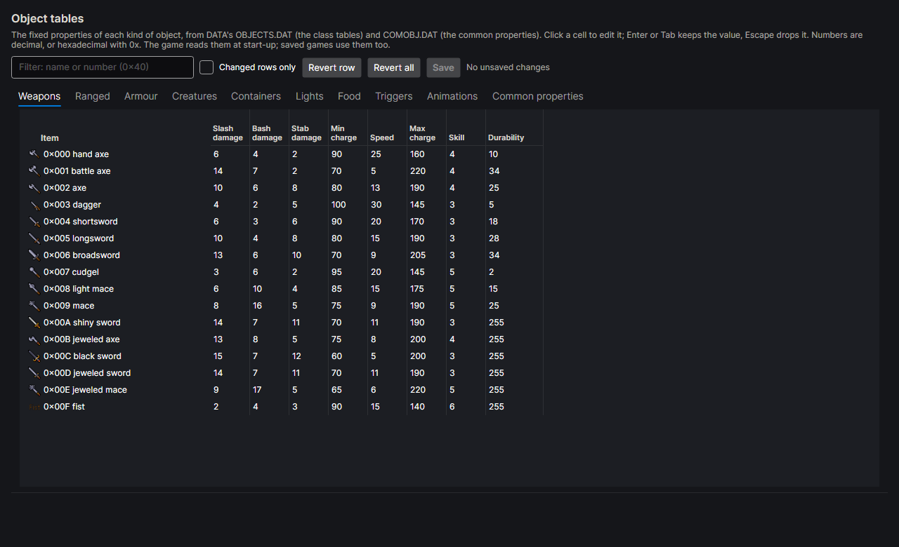</td>
<td>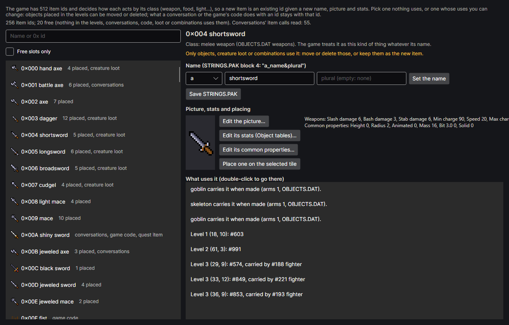</td>
</tr>
</table>

- **Object tables:** OBJECTS.DAT (weapons, armour, creatures, containers, lights, food and
  more) and COMOBJ.DAT in grids, with range checks and what each field means.
- **Item slots:** shows what uses each item id (levels, conversations, the game's code, loot,
  combinations, quest items) and which slots are free, and makes a new item in a free slot:
  its name, picture, stats and placement.
- **Game tables:** each texture's terrain, class skills, item combinations and light levels.
  **Schedules** (UW2) lists SCD.ARK's events, and **File ▸ Saved games** renames, copies and opens saves.

## The automap

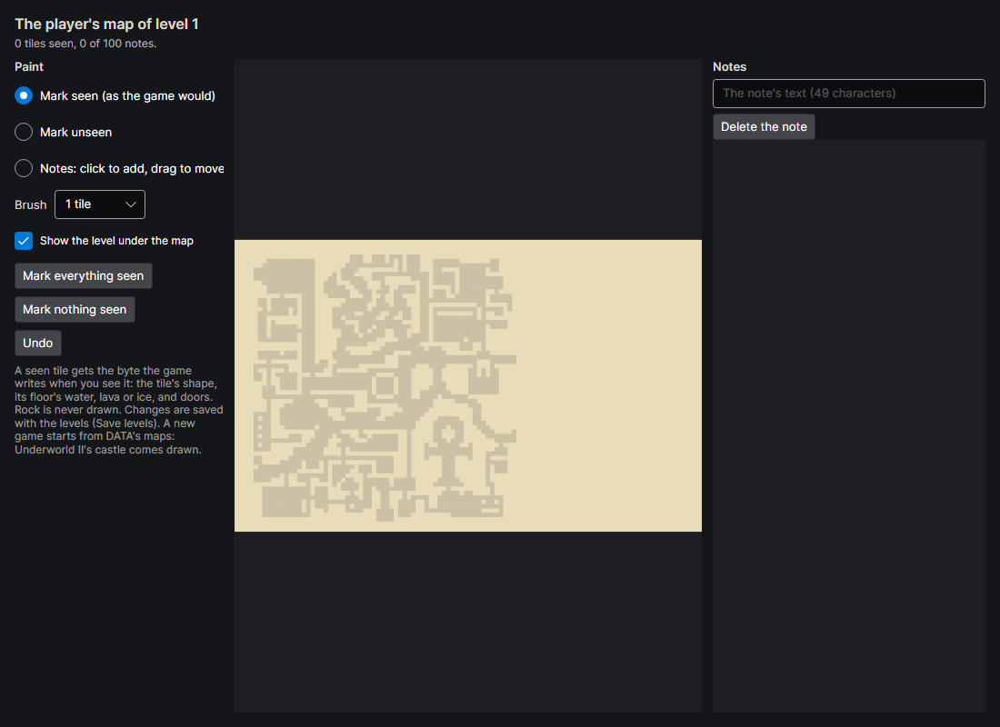

Paint the player's map tiles as seen or unseen, as the game would mark them, and add, move or
delete the map notes (Ctrl+Shift+A), on any level you pick (UW2 by world). In UW1 the map
screen goes on past level 9 to pages of notes alone, up to page 99, and the editor writes them
too. **Check and repair the saved game** fixes notes the game
would read from the wrong level (its own crash bug), broken automap blocks and objects lost
from the lists.

## The randomizer

Turn the game into a fresh run every time, and keep it beatable.

### Key item scatter (UW1 only)

<table>
<tr>
<td>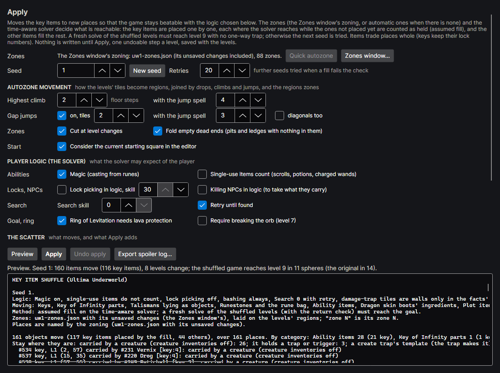</td>
<td>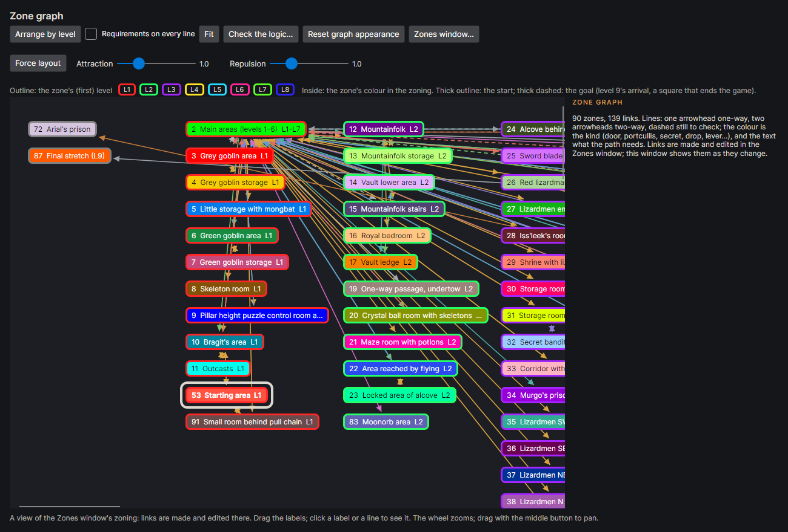</td>
</tr>
<tr>
<td>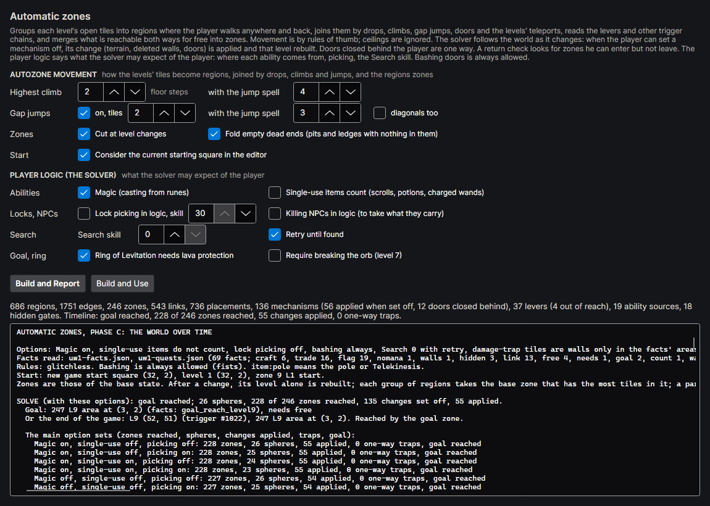</td>
<td>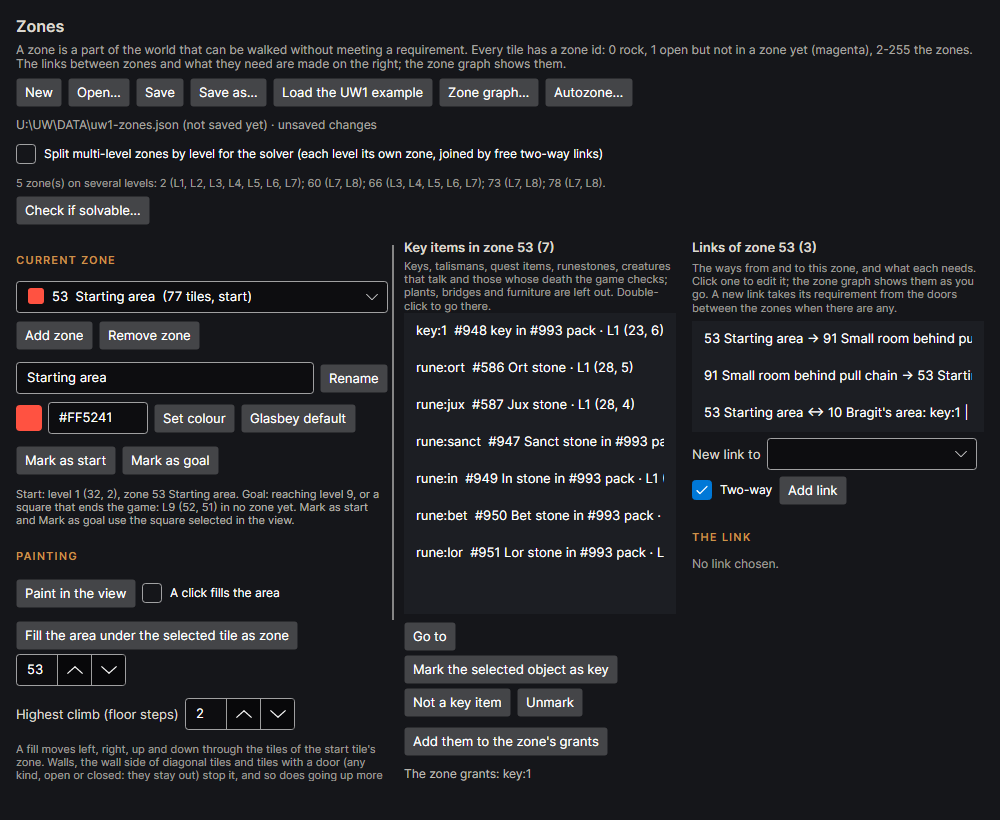</td>
</tr>
</table>

- **Apply** moves the keys, runes, ability and plot items to new places, and a solver that
  follows the world over time checks that the game can still be won under the logic you
  choose. Items on the floor go to random squares the logic reaches (not water, lava or
  traps), or, if you prefer, trade the places where items lay. **Additional items** brings in
  any other kind you pick: weapons, coins, bedrolls, books, even containers with what they
  hold. You get a spoiler log, which can also go into the game's own map notes past level 9:
  hints for the artifacts and the items you cannot finish without, a page that warns the
  solutions come next, then the solutions. Undo puts everything back.
- **Automatic zones** build the logic from the levels themselves: walkable regions, drops,
  climbs, gap jumps, doors, levers and teleports. It knows the player's abilities and where
  they come from (spells, items, the dragon skin boots), hidden walls a look opens, levers
  that change the world, doors closed behind the player, and the quest facts that lead to the
  end of the game. Options cover magic, single-use items, lock picking and the Search skill.
- **Zones** lets you paint the zoning by hand instead, with a live **zone graph** of the zones
  and their links, and a check that it can be solved.

### Shuffles, swaps and challenges (both games)

<table>
<tr>
<td>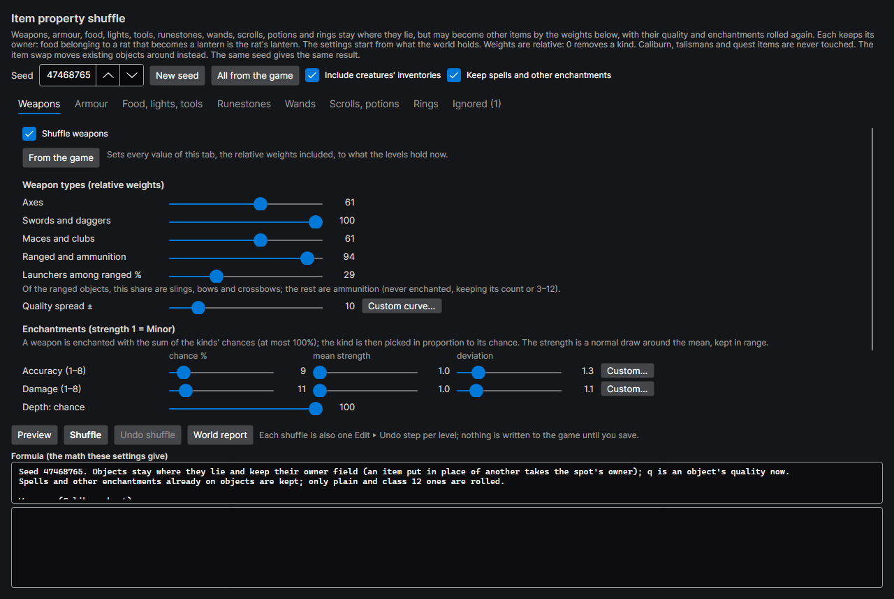</td>
<td>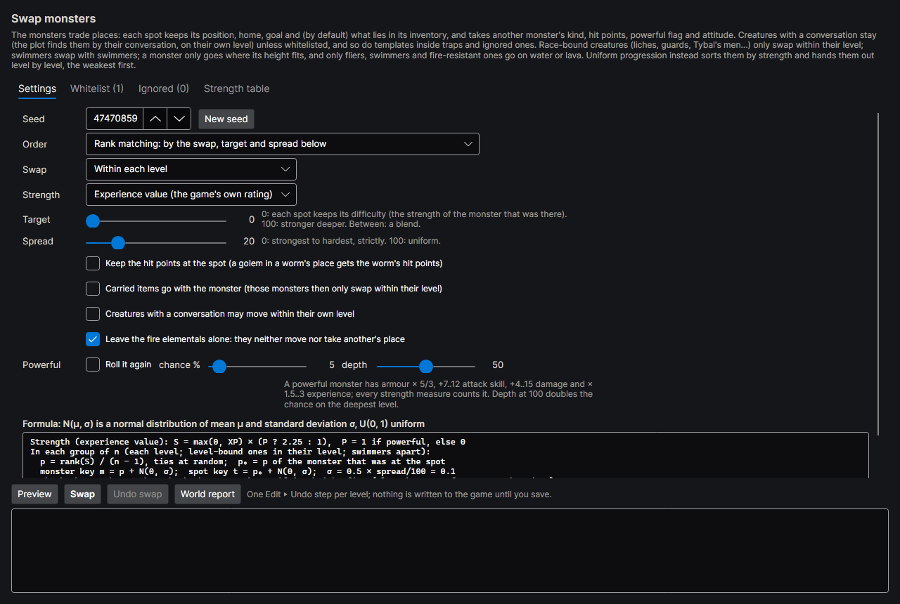</td>
</tr>
<tr>
<td>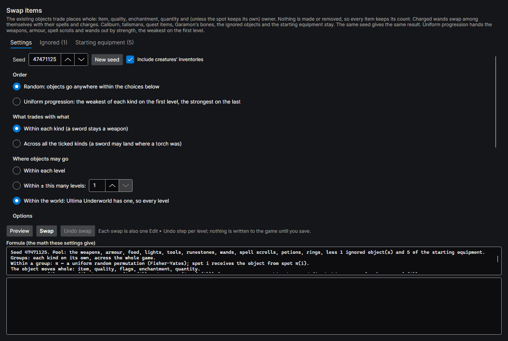</td>
<td>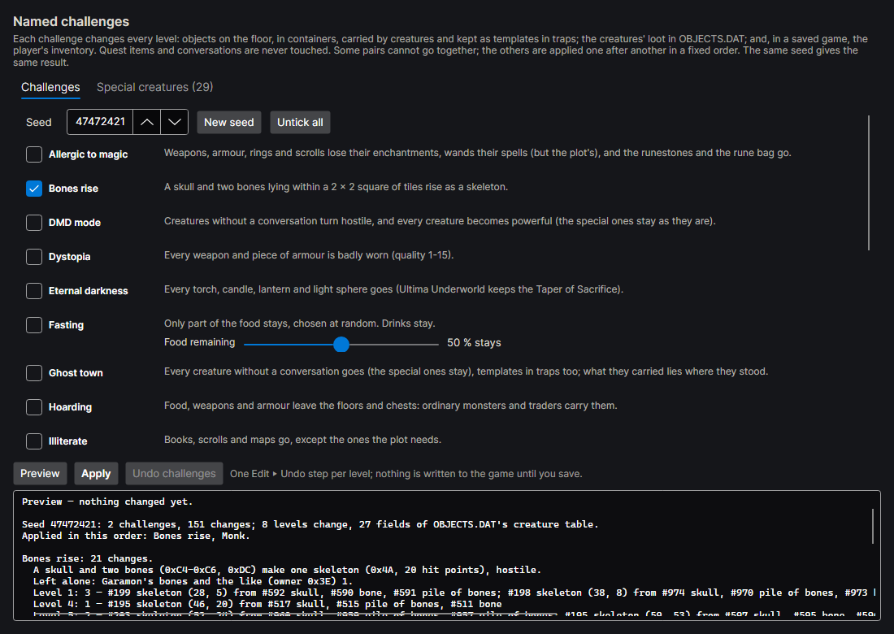</td>
</tr>
</table>

- **Item property shuffle:** weapons, armour, food, lights, tools, runestones, wands,
  scrolls, potions and rings become other items, by weights per type, with their
  enchantments rolled again (chance, strength and depth, as numbers or hand-drawn curves).
  Those lying on the floor can also go to random squares of their level.
- **Swap monsters:** creatures trade places by strength, keeping each spot's difficulty or
  growing with depth. Talkers stay, and nobody lands in water or lava they cannot survive.
- **Swap items:** existing objects trade places within their kind or across kinds, within a
  level, a range of levels or the whole game, and take their spot's owner (the rat's food
  becomes the rat's lantern).
- **Uniform progression:** things are sorted by strength and handed out level by level, the
  weakest first.
- **Named challenges:** 21 whole-game rules (Monk, Lockdown, Hoarding, Ghost town, Bones
  rise…) with a preview and an exact Undo. Quest items and conversations are never touched.
- **Randomize mantras (UW1):** the shrines' mantras swap words, and every book, scroll and
  conversation that names one follows.
- **Vowel play:** proper names get their vowels shuffled (Garamon becomes Guromon) in every
  string, with passwords and the mantras left alone.

No randomizer touches the glowing rocks of UW1's Pac-Man maze (level 5).

The shuffles and swaps show their maths as a live formula and write a world report. Every tool
makes one undo step per level.

## Testing in the real game

- **Play test** (F5) starts the game in DOSBox from a copy, with your unsaved levels and the
  player on the selected square.
- **Check in Underworld Exhumed** loads your edits with the game's own code, in
  [Underworld Exhumed](https://github.com/abedegno/underworld-exhumed)'s native port: a
  level-16 player visits each chosen level, and the levels the game wrote back are checked.
- **DOSBox spot test** turns chosen squares into saved games 1–4 with a fresh, armoured
  tester on each, and offers the next four when DOSBox closes.
- **Export as a saved game** writes your edits as a `SAVEn` folder.

## Mods, checkpoints and safety

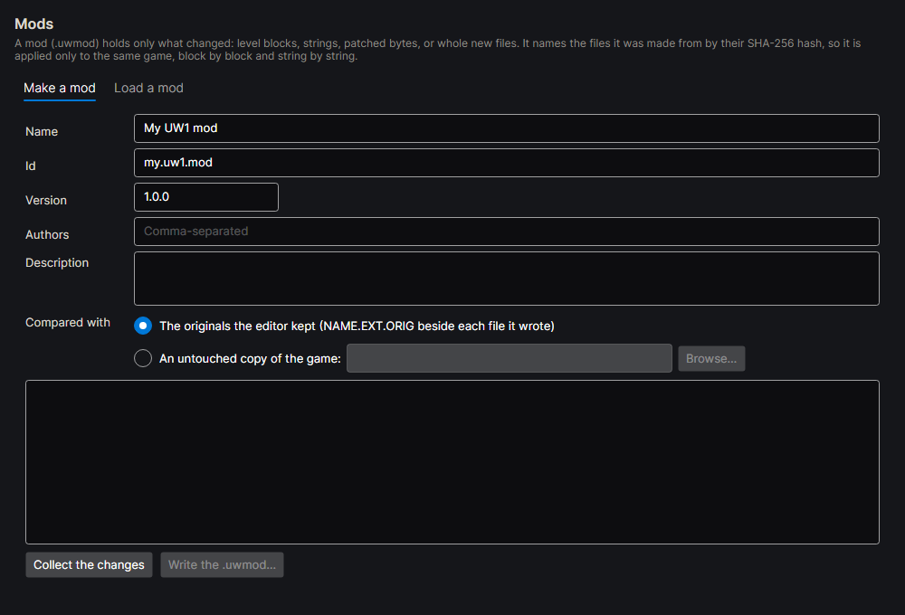

- **Mods** (Ctrl+Shift+M): **Make a mod** writes a `.uwmod` that holds only the differences
  from the game's own files, never the files themselves, with the SHA-256 of each original.
  UW2's compressed blocks are compared uncompressed. A mod changes files the game has, and adds
  only sounds the game opens by number. **Load a mod** applies it to those exact originals,
  giving back the saved files byte for byte. The format is in
  [docs/mod-format.md](docs/mod-format.md). **Changed files as a .zip** packs the changed
  files whole, at their folders, to unzip over your own copy of the game (not for the mod
  manager, and not to share: it holds game data).
- **Backups:** every file written keeps its previous version as `.BKP`, and its first version
  as `.ORIG`.
- **Checkpoints:** while there are unsaved changes, a copy is taken every 5 minutes and the
  newest 20 are kept (both numbers can be changed). Restoring loads one back as edits that can
  be undone.
- **Crash recovery:** an unexpected error is logged and the unsaved work is kept; the next
  start offers it back.
- **Light or Dark, Compact or Comfortable:** a colour scheme, and either the classic, tighter
  Compact layout or the roomier Comfortable one. Light and Compact are the defaults, and the
  choice is remembered between runs. The mod manager shares the look (`src/UwEditor.Look`).

**Help ▸ Manual** (F1) opens [the manual](docs/MANUAL.md), built into the program with its
sections and a search box; F1 in a tool window opens that tool's section. **Help ▸ About**
shows the version (`<Version>` in `Directory.Build.props`, raised with every change: 0.1.0,
0.1.1…; the mod manager has its own, shown in its Settings). The plan is in
[PLAN.md](PLAN.md) and the road ahead in [ROADMAP.md](ROADMAP.md).

## Downloads

Ready-made builds for Windows, Linux and macOS are on the
[Releases page](https://github.com/KarlClinckspoor/UltimaUnderworldEditorAvalonia/releases).
They are made by `.github/workflows/release.yml`: run it from the Actions tab, or push a tag
such as `v0.2.0-beta`.

## Building and running

You need the [.NET 10 SDK](https://dotnet.microsoft.com/download).

```
dotnet run --project src/UwEditor.App
dotnet run --project src/UwEditor.App -- "C:\Games\UW2\SAVE1"      # open a folder at start
dotnet run --project src/UwEditor.App -- "C:\Games\UW2" --level 66  # and show a level
```

To build a self-contained program:

```
dotnet publish src/UwEditor.App -c Release -r win-x64 --self-contained
```

Use `-r linux-x64` or `-r osx-arm64` for the other systems. On Linux without a GPU driver,
Mesa's software renderer is used, which Avalonia normally refuses. The view is slower that
way, but it works.

## Tests

```
dotnet test
```

The test projects:

| Project | What it tests | Needs |
|---|---|---|
| `tests/UwEditor.Core.Tests` | loading, levels, geometry, models, picking, the grid, on the shipped data of both games | the game files |
| `tests/UwEditor.App.Tests` | the main window, the find window, the conversation editor, the global variables window, the player window and the graphics window in Avalonia's headless mode: typing, clicking chips, keys, selection, the properties panel, find and go to, saved games, editing and saving strings, scripts and values (on a copy of the game); plus pictures of the windows compared with baselines | the game files |
| `tests/Underworld.Mods.Tests` | mod packages (format 2): deltas and their BLOCK op on UW2's compressed archives, damaged and hostile packages, which files a mod may change or add | the game files |
| `tests/ModRoundTrip.Tests` | round trips: an edit made with the editor's core (levels, the randomizer's scatter, swaps and challenges, SHADES.DAT, OBJECTS.DAT and COMOBJ.DAT, the other tables, schedules, the start square, sounds, music, strings, conversations, pictures, all at once), packaged by Make a mod and installed by the mod manager, gives the same files byte for byte, and the original game comes back; see [docs/mod-format.md](docs/mod-format.md) | the game files |
| `ModManager/tests/UwModManager.Tests`, `UwModManager.UiTests` | the mod manager: DOS folders (journal, recovery, outside changes, UltimaHacks), Exhumed homes, saved-game backups, its screens headless | the game files |
| `tests/UwEditor.Screenshots` | the real program with its OpenGL view on a private virtual screen (Xvfb + Mesa): what it draws, clicking an object in the view, camera keys, the grid; pictures compared with baselines, facts read from the program's `--state-file` | Linux with `Xvfb`, `xdotool` and ImageMagick; skipped elsewhere |

The game files come from `UW_GAMEDATA`, a folder holding `UW` and/or `UW2`, each with its
`DATA` folder and executable (UW2's `SAVE1`/`SAVE2` are used if present). Failing that, they
come from `tests/gamedata/` (`tests/gamedata/UW`, `tests/gamedata/UW2`), which git ignores; a
`gamedata/` folder at the top is still read when `tests/gamedata/` is missing. Use an unchanged
install there: tests that compare against a clean game fail on one with saved games or edited
levels. Tests whose game is missing pass without checking anything. Set `UW_REQUIRE_GAMEDATA=1` to make them fail instead.

**Picture baselines.** The first run of a picture test records its baseline under
`tests/<project>/baselines/` and reports the test as skipped. Look at the pictures; later runs
compare against them. A pixel differs when a colour channel is off by more than 40, and up to
1% (headless) or 2% (OpenGL) of the pixels may differ. A mismatch writes the actual picture and
a diff, with differing pixels in magenta, to `TestResults/snapshots/`. After an intended change
of the look, run with `UPDATE_SNAPSHOTS=1` to record new baselines. The baselines show the
game's graphics, so they are made from your own game files and not committed.

**The README's pictures.** The tool windows in `docs/images` are drawn headless by
`ReadmePictures` in the interface tests, which only runs when `UW_README_PICTURES` names the
folder to write to:

```
UW_README_PICTURES=docs/images dotnet test tests/UwEditor.App.Tests --filter ReadmePictures
```

The pictures of the 3D view are screenshots of the program itself, opened with `--size 1440x900`
and, for some, `--select N`, `--light N`, `--walk` or `--window map`.

The core tests check, among other things:
- random edits (tiles, adding, deleting, moving, putting inside, copy and paste, fields, undo
  and redo, from fixed seeds on levels of both games): after each one the game's object-list
  check passes and no new list error appears; the level reads back the same from the saved
  archive; undoing everything gives the original bytes and redoing everything the edited ones.
  `UW_RANDOM_EDITS=N` runs N more seeds a game;
- every level of both games loads and passes the game's object-list check;
- UW2 has 42 levels, and slot 73 has 1,046 open tiles and 427 objects;
- the start squares in the executables;
- a saved game's player position;
- names, textures and object pictures;
- that the view is not mirrored;
- picking;
- that every level builds a valid mesh;
- that levers, doors and furniture become models, and a wall lever lies on its wall;
- that every shipped open door is 24 above its floor, so it is drawn on the floor (the
  reference's rule);
- the grid lines and their labels;
- conversations:
  - every shipped conversation of both games (97 and 102) is read and written back to the
    same bytes;
  - every one disassembles and assembles to the same bytes;
  - CNV.ARK and STRINGS.PAK save unchanged to the same bytes;
  - an edited block leaves the others as they were;
  - the readable view finds the says, menus and quests;
  - values edited in a copy of a UW2 save are written to PLAYER.DAT and BGLOBALS.DAT, changing
    only their own bits;
- the player:
  - UW2 saves read with their inventories;
  - rewriting an inventory numbers it as the game does;
  - adding and removing objects keeps links and slots right;
  - values UW2's cheat detection would catch are warned about;
  - creation limits come from SKILLS.DAT;
  - UW1 records (made in the test) keep their appearance bits;
- graphics:
  - every picture file of both games reads, saves unchanged to the same bytes, and imports its
    own exports index for index;
  - a replaced sprite is written and read back;
  - imports refuse wrong sizes, missing colours and transparency in solid pictures;
  - every critter frame decodes, and a replaced frame reads back;
  - a critter page that would pass 0x7FFF bytes is refused;
  - cutscene frames decode, a replaced frame is re-encoded and the others stay as they were.

**Options for scripted runs** (used by the screenshot tests):
- `--level N`: show this level first;
- `--select N`: select and frame this object;
- `--size WxH`: the window's size;
- `--ready-file F`: written once the first level has been drawn;
- `--state-file F`: level, selection, camera and view rectangle as JSON after every change;
- `--conversations [N]`: open the conversation window (on slot N); `--tab N` picks its tab;
- `--globals`: open the global variables window;
- `--player` / `--graphics`: open the player or graphics window (`--tab N` picks the tab);
- `--window NAME`: open a tool window or view (`map`, `zones`, `zonegraph`, `keys`, `strings`,
  `triggers`, `mods`, `models`, `sound`, `music`, `fonts`, `automap`, `autozones`, `challenges`…);
- `--light N`: the game's light level N (0 none … 7 the brightest); `--walk`: first person at
  the start square.

## Layout

| Project | What it is |
|---|---|
| `src/Underworld.Formats` | The Unity editor's format code, copied (see its `SOURCE.md`). .NET Standard 2.0. |
| `src/UwEditor.Core` | Opening games, levels, tiles and objects, the level mesh, the camera, picking, property rows; conversations (`Conversations/`: CNV.ARK, the assembler and readable view, STRINGS.PAK editing, global variables); the player record and inventory (`Player/`); pictures, critter art, cutscenes and PNG (`Graphics/`). No UI. |
| `src/UwEditor.Look` | The look the editor and the mod manager share: the Light and Dark colour schemes and styles, the Compact layout (`Density`), the icons. |
| `src/UwEditor.Render` | The OpenGL drawing (Silk.NET), GL 3.3 or GLES 3.0. No window toolkit. |
| `src/UwEditor.App` | The Avalonia program: window, menus, panels, the GL view control, the find, conversation, global variables, player and graphics windows. |
| `tests/UwEditor.Core.Tests` | xUnit tests on the real game files. |
| `tests/UwEditor.App.Tests` | Headless interface tests of the Avalonia windows. |
| `tests/UwEditor.Screenshots` | Screenshot tests of the program with its OpenGL view (Linux). |
| `tests/Shared` | Picture comparison and baselines, shared by the two interface test projects. |
| `src/Underworld.Mods` | Mod packages, format 2 ([docs/mod-format.md](docs/mod-format.md)): deltas from the game's own files, shared by the editor and the mod manager. No UI. |
| `tests/Underworld.Mods.Tests` | Its tests, on the real game files. |
| `ModManager/` | The Ultima Underworlds Mod Manager (app, `uwmod` command line, tests), brought in from its own repository. It installs format 2 mods into DOS folders and Underworld Exhumed homes; see its [README](ModManager/README.md). |

The meaning of the files comes from
[underworld-exhumed](https://github.com/abedegno/underworld-exhumed), the reconstructed source
of both games, which is the reference.

## License

The editor's source code is under the [MIT License](LICENSE). Ultima Underworld and its game
files belong to their rights holders and are not covered: the repository holds none of them,
except the application icon, which is drawn from UW1's black sword picture.

The editor plays sound through [OpenAL Soft](https://openal-soft.org/) (via Silk.NET), which is
under the GNU LGPL (2.0 or later) and is loaded at run time as a separate library (`soft_oal.dll`,
`libopenal.so`, `libopenal.dylib`; the single-file builds carry it inside and extract it when
the editor starts).
