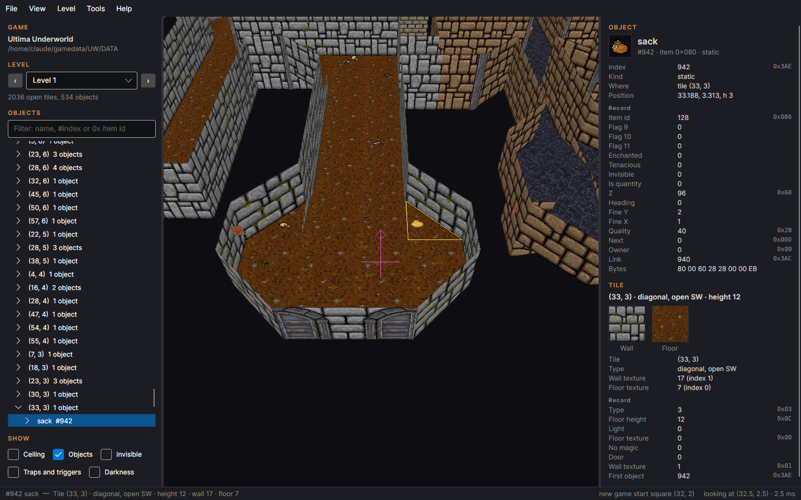
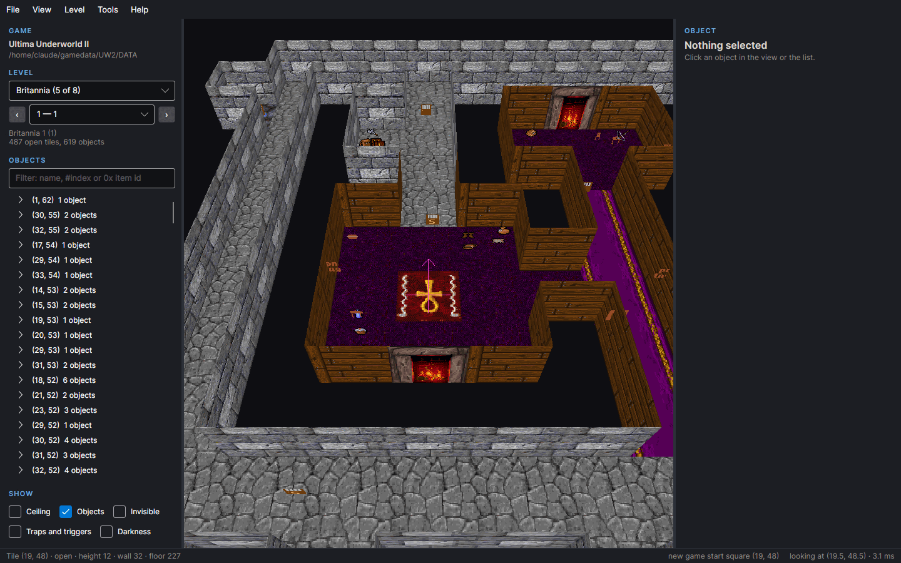

# Underworld Editor (Avalonia)

A level editor for **Ultima Underworld I** and **II** that runs on Windows, Linux and macOS.
It uses Avalonia 12 for the window and OpenGL for the 3D view. It opens a game, shows any
level in 3D, edits tiles and objects, and also edits conversations, strings, keys, the
player and graphics. Changes can be packed into mods. The plan is in
[PLAN.md](PLAN.md); the road to the Unity editor's other features is in
[ROADMAP.md](ROADMAP.md).



## What it does

- **File ▸ Open game folder…** (Ctrl+O). Choose the game folder (the one with `DATA` in it),
  the `DATA` folder itself, or a saved game (`SAVE1`…). The game is recognised by its
  files. A saved game takes its levels and player from the save, and everything else from
  `DATA`.
- **The camera starts over the start square of a new game.** The square is read from
  `UW.EXE` / `UW2.EXE`, so a patched start square shows too. In a saved game the camera
  starts over the player, facing where the player faces. A large **red arrow** marks the
  new-game start; in a saved game a **green arrow** marks the player.
- **Picking a level:**
  - UW1: levels 1–9.
  - UW2: pick the world, then a slot in it. Empty slots are marked.
  - PgUp and PgDn step through the levels.
- **The 3D view:**
  - Floors, walls, slopes and diagonal walls, textured through the level's texture map.
  - The ceiling (G), seen only from below, as in the game.
  - Objects drawn the game's way, from COMOBJ.DAT's render field:
    - doors in their frames (open doors swung by their flags, the portcullis raised, the
      secret door in the wall texture);
    - levers, switches, writings and paintings on their walls;
    - furniture, pillars, bridges and so on as the 3D models built into `UW.EXE` /
      `UW2.EXE`;
    - everything else as its picture, always facing the camera.
  - M switches the models off. Invisible objects and traps or triggers can be shown too.
  - A yellow grid every N tiles (H; N set in the Show box), laid on the floors. The view's
    edges name each line, as `X: 30` or `Y: 45`.
  - **Light** (in the Show box): full light, or one of the game's eight light levels. These
    are no light, candle, torch, taper, lantern, night vision, light sphere or Wizard Eye, and
    the brightest. The view is then shaded as the game shades it. Each square gets one of the
    16 shading maps of LIGHT.DAT (MONO.DAT's greys for night vision), by its distance in
    squares and the level's row of SHADES.DAT. Squares beyond the level's range are not drawn.
    The centre is the point looked at, or the eye in first person. In UW2, a level DL.DAT
    never lets go darker shows at its minimum.
- **Finding objects:**
  - Creatures that talk show their name and unique objects their plot name in brackets,
    as in "fighter (Corby)" and "shiny sword (Caliburn, the Sword of Justice)".
    Enchanted objects show their enchantment.
  - The search box matches item names, NPC names ("human (Lord British)"), the text of
    books, scrolls, writings, gravestones and text traps, `#index` and `0x` item ids.
  - The chips narrow the list to weapons, food, monsters, keys, traps or triggers (any of
    those chosen), and Enchanted to enchanted objects.
  - Each line shows the object's picture as the game shows it.
  - **Level ▸ Find in all levels…** (Ctrl+Shift+F) runs the same search, with every item
    kind, over all levels. Double-click a result to open its level with the object selected.
- **Selecting:**
  - Click an object or a tile in the view, or pick one in the object list.
  - The list shows the objects lying on tiles in index order. Whatever is inside an object
    (container contents, inventories, a trigger's trap, a door's lock) hangs under it.
  - The filter takes a name, `#index` or `0x` item id.
- **Properties:** every field of the object and tile records, with its value in decimal and
  hex. The tooltip gives the field's meaning and its source in the reconstructed game code.
  Fields whose meaning is only inferred or unknown are marked. The tile panel also shows
  its wall and floor textures.
- **Level ▸ Automap and map notes…** (Ctrl+Shift+A) edits the player's map of a level: paint
  tiles seen or unseen as the game would mark them, and add, move or delete the map notes.
- Changing level keeps the camera over the same X and Y.
- **Level ▸ Check the object lists:** runs the game's own consistency check (Obj_ListOkay).
- **Tools ▸ Conversations…** (Ctrl+Shift+C): every conversation in CNV.ARK, by slot and the
  name the creature talks under. The list filter matches slots, names and any text a
  conversation says. Four tabs:
  - **Dialogue:** what the script does, rebuilt from its code by following the
    machine's stack (conv/BABL.C). It shows the say and respond lines with their text, each
    menu with its numbered choices, and the checks on quests, variables and the talker's
    state. Simple `if` blocks are folded; other jumps stay as labels. Functions the script
    never calls (the compiler's small library) are hidden unless you ask. Double-click a
    line to see its code.
  - **Strings:** the conversation's block of STRINGS.PAK, edited in place. Each string shows
    where the script uses it. **Add string** appends one, for the script to say.
  - **Script:** the code as assembly, one instruction a line (conv.h's opcodes):
    - labels for jumps and calls;
    - imported functions by name;
    - the header and import table as directives;
    - comments with each address and the strings.
    **Apply** (Ctrl+Enter) assembles it. A mistake is reported at its line. Disassembling
    and assembling every shipped conversation of both games gives back the same bytes.
  - **Who talks:** the creatures in the levels that use the slot (whoami, or the generic
    slot for whoami 0). Double-click one to go to it in the main window.
  **Save** (Ctrl+S) writes CNV.ARK and STRINGS.PAK in `DATA`, with only the changed blocks
  rewritten. UW2's blocks are compressed again. The old files are kept as `CNV.ARK.BKP` and
  `STRINGS.PAK.BKP`. Edits stay in memory when the window closes, until the game is closed.
- **Conversation simulator** and **Conversation graph** (Tools menu, or the conversation
  window's Simulate… and Graph…): run a conversation with its menus, variables and the game's
  state, or see its flow as nodes with editable strings. Saving conversations keeps
  `BABGLOBS.DAT` / `BGLOBALS.DAT` records in step.
- **Tools ▸ Global variables…** (Ctrl+Shift+G): the game state conversations can read and
  change, with the conversations that read and write each:
  - quest flags and quest bytes (`get_quest`, `set_quest`);
  - the game variables traps share (`x_traps`; UW2's numbered variables);
  - UW2's X clocks (`x_clock`);
  - skills (`x_skills`);
  - the talker's and player's variables copied in and out (`npc_attitude`, `play_hp`…);
  - each conversation's own globals, kept in `BGLOBALS.DAT`.
  The uses come from the constant arguments of those calls. With a saved game open, the
  values come from its `PLAYER.DAT` and `BGLOBALS.DAT`; they can be changed and saved, and
  the old files are kept as `.BKP`. With `DATA` open, a new game, they read 0. Double-click a
  use to open its conversation at that line.

- **Tools ▸ Player and inventory…** (Ctrl+Shift+P), with a saved game open. It edits the
  saved character in `PLAYER.DAT`:
  - name, class, sex, hand and portrait (the HEADS.GR picture shown);
  - attributes, vitality, mana, hunger, fatigue, carrying capacity;
  - level, experience, skill points and the twenty skills.

  **Checks** are listed beside it and update as you type:
  - **Game detects:** in UW2, strength + dexterity + intelligence above 64 makes the
    end-of-game screen add "AND CHEATED ON THEIR CHARACTER" (game/SKILLS.C `game_stats`).
    UW1 has no such check.
  - **Not reachable:** values creation and play never give. Attributes over 30 or outside
    the class's start in SKILLS.DAT, skills over 30, a sixth portrait, levels outside 1–16.
  - **Notes:** maxima that disagree with what the game computes (`player_compute`), a level
    the experience has not earned, and the like. *Set the maxima as the game computes them*
    fixes those.

  The hand bit means right-handed in UW1 and left-handed in UW2: their creation menus list
  the choices the other way round, so the labels come from CHRGEN.DAT. The **Inventory** tab
  shows the worn and held objects, the pack and container contents, with icons:
  - each object's id, quality, owner, quantity or special, flags and slot can be changed;
  - objects can be added to the pack or into a container, or removed.

  Saving renumbers the objects depth first, as the game's `InvSaveNexts` does. Rewriting a
  shipped save's inventory unchanged gives the same bytes, except slots 19–27 (an open
  bag's view, which the game rebuilds): those are cleared. The old file is kept as
  `PLAYER.DAT.BKP`.
- **Tools ▸ Graphics…** (Ctrl+Shift+R), with three tabs:
  - **Pictures:** every `.GR`, `.TR`, `.BYT` and UW2's `BYT.ARK` in DATA, as thumbnails.
    Each is shown large with a palette of PALS.DAT; UW2's screens start in the palette the
    game shows them with.
  - **Critter animations:** the CRIT art files by the creatures that use them. Their
    animations come from the UW1 page headers or UW2's `CR.AN`. Pick an auxiliary palette;
    play the animation or step through its frames.
  - **Cutscenes:** every CUTS cutscene and its LPF animations, with a frame slider, playing
    at the file's frame rate.

  **Export** writes an indexed PNG whose palette is the picture's own colours (its 16 or 32
  auxiliary colours, or the 256 of the palette), so the indices survive a round trip.
  **Export all frames** writes a cutscene animation as numbered PNG files.

  **Import** takes a PNG back and refuses:
  - **another size**;
  - **colours the picture cannot use:** a 4-bit sprite has 15 colours and transparency,
    a critter frame 31 or 15, an 8-bit picture its palette. The list names each missing
    colour with its pixel count and the nearest one it has; *Use the nearest colours*
    maps them instead;
  - **transparency** in a picture the game draws solid (textures, screens);
  - **files the game could not load:**
    - a critter page over the 0x7FFF bytes `load_cpg` reads;
    - a cutscene page over its 64 KB window or 256 records;
    - more than 256 pages;
    - texture and screen sizes are fixed.

  A replaced cutscene frame re-encodes only its own delta, the next frame's and the loop
  back to the first. Saving keeps each old file as `.BKP`.

### Editing levels

Each level keeps its own undo history (Ctrl+Z, Ctrl+Y). **Save levels** (Ctrl+S) writes
LEV.ARK and keeps `LEV.ARK.BKP`, plus `LEV.ARK.ORIG` the first time. The toolbar above the
view chooses the tool:
- **Select:** a click picks an object or tile; a double click also moves the view to it
  (so does double-clicking in the list).
- **Move:** click a square and the selected object goes there, keeping its height above the
  floor. A critter's home moves with it.
- **Paint:** drag over tiles to paint the light flag on or off (only that bit), a floor or
  wall texture from the level's texture list (shown with thumbnails), a tile type, a
  floor height, or a tile template (type, height and textures together). **Fill** paints
  every tile walkable from the one clicked; **Paint selection** paints the selected tiles.
- **Ctrl+wheel** raises or lowers the floor under the mouse, and the objects on it with it.
- **First person** (P): walk the level at eye height. W A S D walk, Q E or a drag turns,
  R V look up and down, and Esc leaves. Rock and floors more than two steps up stop you.

Any record field can be typed into in the properties panel (decimal or `0x` hex), except
the list links, which the editor keeps. Small fields (fine X and Y, height, quality,
owner, heading) have − and + buttons; hold them down to repeat. One-bit flags (invisible,
enchanted, is quantity and so on) are checkboxes. The heading shows as an arrow, with north
up. An owner field has a list of the races to choose
from. Each race is named by its creatures, from OBJECTS.DAT's race byte.

**Add…** (Insert) opens a window that lists the items as a tree. The groups are the object
list's kinds (melee weapons, armour, containers and so on); a search opens the groups that
match. The form changes with the kind of item:
- a boulder or food gets quality, owner and quantity;
- a weapon, armour or ring gets its enchantment, from the weapon/armour list (which names
  what each really does) or the 64 spells, with how it is stored. In UW2 a warning says
  that the game's own names swap the Accuracy and Damage enchantments;
- a wand gets its spell and charges, kept in a spell object inside it;
- a book or scroll gets its text, previewed;
- a key gets its lock and description, and a lock gets its number, locked flag and
  lockpicking difficulty;
- a creature gets hit points, attitude and conversation;
- a trap or trigger gets its description.

The new object goes on the selected tile or into the selected container. The player
window's **Add…** uses the same form for the inventory. **Delete** (Del) frees the object
and what it holds.

**Traps and triggers:** selecting one shows what its kind does and what each field means,
from event/TRIGGER.C. The square it acts on gets a **red bullseye**: a trigger's target, a
teleport's destination, a delete trap's square, or where the chains that reach a trap run.
**Choose the target in the view** lets you click the square instead of typing it; a
teleport can aim at another level; one to another level shows its bullseye faded with the
level named, and **Go to the teleport's target** opens it. **Variable in globals…** opens the global variables
window on the variable a set or check variable trap uses.

**Selecting several, copying, dragging:** Ctrl+click adds objects or tiles to the
selection and Ctrl+drag selects tiles in a rectangle. Copy, cut, paste and duplicate
(Ctrl+C, X, V, D) take objects with everything inside them (contents, a wand's spell, a
trigger's traps) to any level of the same game. A selected object can be dragged to another
tile, or onto a container, creature or trigger to go inside. A right click opens a menu of
what can be done with the object or tile under the mouse.

**2D map** (View menu, Tab): the level straight down without perspective; the map can be
exported as a PNG. **Undo history** (Ctrl+H) lists a level's steps and goes back to any.
**World check** (Level menu) finds locked locks no key opens, keys with no lock, and levels
near the object limits. **Play test** (F5) runs the game in DOSBox from a copy with the
unsaved levels and the player on the selected square. **Trap recipes** (Edit menu) build a
lever for a door, teleports there and back (also to another level), pressure plates and
pick-up, use or look triggers running damage, a message, a variable, a new object or
creature, a door or a removal, and wandering-monster spawners (UW2's random monster
included), each as one undo step; the triggers window labels the shipped spawners. **Fixes** (Level menu) finds and
repairs object-list and game-logic problems; the **Item cleaner** removes debris, bones,
junk or any loose items while keeping quest items, keys, texts and trap-linked objects.
**Make this slot a level** and **Clear the level** (Level menu) create or empty levels.

**The start and the player:** with the Move tool, click an arrow and then a square. The
new-game start can only move on level 1: it is patched into `UW.EXE` / `UW2.EXE`, which is
kept as `.ORIG`. The player in a saved game can go to any level, and is saved in
`PLAYER.DAT`. Clicking the green arrow opens the player window. Edit ▸ Move the … here
uses the selected tile.

**Checkpoints** (File ▸ Checkpoints…): while there are unsaved changes, a copy of them is
kept every 5 minutes. A copy holds the changed levels, plus STRINGS.PAK or PLAYER.DAT when
they have unsaved edits. The newest 20 are kept. Both numbers can be changed: the interval
from 0 (never) upwards, and up to 1000 copies. Restoring loads a checkpoint back as unsaved
edits that can be undone; the game folder is not touched until you save.

**Colour scheme:** View ▸ Colour scheme ▸ Dark or Light, remembered between runs.
**Layout:** View ▸ Layout ▸ Comfortable or Compact: a classic, XP-like layout with tighter
controls and borders in place of white space, in either colour scheme; font sizes stay.

### More tools

- **Tools ▸ Keys and locks…** (Ctrl+Shift+K): every lock number with its keys and locks
  across all levels, where each lies, whether it is locked, and the keys' description
  (STRINGS.PAK block 5, 100 + the number), which can be edited. Double-click to go there.
- **Tools ▸ Triggers and traps…** (Ctrl+Shift+T): every trigger of the level, where it
  lies, the square its chain runs on and each trap in the chain, then the traps no trigger
  reaches. A line explains itself; double-click goes to it in the map.
- **Tools ▸ Strings…** (Ctrl+Shift+S): every block of STRINGS.PAK, with the conversations
  named, searched in one block or all of them. Strings can be edited and added, and
  characters the file cannot write are refused. Saving updates the names everywhere in the
  editor. It shares the conversation editor's copy of the file, so edits made in both are
  never written over each other.
- **Tools ▸ Mods…** (Ctrl+Shift+M):
  - **Make a mod** compares the game with the originals the editor kept (`.ORIG`), or with
    an untouched copy, and writes a `.uwmod` (a zip with `mod.json`). It holds only what
    changed: LEV.ARK and other archive blocks, single strings, bytes patched in place (an
    executable's start square, never the program itself), or whole new files. It records
    the SHA-256 of each file it was made from.
  - **Load a mod** checks it against the open game, block by block and string by string
    (fits, already applied, changed since, missing). It then applies it and opens the game
    again.

- **Pixel editor** (graphics window's Edit pixels…, or an object's right-click menu): draw on
  any picture with its own colours (the palette, or a 4-bit picture's 16), with pencil, eraser,
  picker, fill, lines and rectangles, a brush of 1-16 pixels and undo; saved in place. The colours the
  game cycles (water, lava, fire) are marked and can be animated.
- Object names are coloured by attitude (hostile red … friendly blue) and enchantment
  (purple), traps and triggers underlined; dragging places objects to the eighth of a tile;
  the camera keys glide.
- **Run and Test**: run the game in DOSBox (with GOG's configuration and C: on the folder
  being edited) or in Underworld Exhumed (on the save being edited), play-test from a tile,
  and **Check in Underworld Exhumed…**: the edits loaded by the game's own code, in
  [Underworld Exhumed](https://github.com/abedegno/underworld-exhumed)'s native port run with
  no window: the player is sent to each chosen level, UW1 saves at the end and the levels the
  game wrote are checked again. **File ▸ Export as a saved game…** writes the edits as a
  `SAVEn` folder, for the port or DOSBox.
- **File ▸ Check and repair the saved game…**: map notes the game reads from another level's
  automap (its own bug, which crashes the map screen), notes with no end, bad automap blocks,
  and objects lost from the object lists ("Problems in object list"), repaired as unsaved
  edits. A saved game opens from a folder of any name, and from outside the game folder.
- **Crash recovery**: an unexpected error is logged and the unsaved work kept in a
  checkpoint; after a crash or kill, the next start offers that checkpoint back.
- **Tools ▸ Item slots…**: what uses each item id (levels, conversations, the game's code,
  creature loot, combinations, quest items) and free slots, to make a new item from one: name and
  plural, picture, stats, placing.
- **Tools ▸ Object tables…**: OBJECTS.DAT (weapons, missiles, armour, creatures,
  containers, lights, food, trigger modes, animations) and COMOBJ.DAT (every item's common
  properties) in grids, with range checks and what each field means.
- **Tools ▸ Game tables…**: the terrain of each texture, class skills, item combinations,
  light levels and UW2's minimum light; **Level ▸ Level textures…** changes the textures a
  level uses, with thumbnails.
- **Tools ▸ Schedules…** (UW2): SCD.ARK's scheduled events with named fields.
  **File ▸ Saved games…**: rename the save slots, copy one to another (with a backup), open one.
- **Tools ▸ 3D models…** (Ctrl+Shift+O): the 32 models built into the executable, shown
  flat-shaded in their palette colours (drag to turn). For each one it gives the points,
  faces and colours, its place and room in the executable, and the items drawn with it.
  **Export OBJ…** writes a Wavefront OBJ file with an MTL of the colours; **Export all…**
  writes every model.

- **Tools ▸ Sound and music**: play, export and replace the speech and digitised effects from WAV
  files (converted and checked against the games' limits), edit SOUNDS.DAT, add UW2 trap sounds;
  export any music theme as MIDI and import MIDI files as new themes (FM and MT-32 versions),
  checked against the game's limits. The editor does not play the music.
- **Randomizer ▸ Scatter** (work in progress):
  - **Zones** paints a zone id on every tile, with Glasbey colours and an overlay in the
    view, and lists each zone's key items.
  - **Zone graph** has movable zone labels, one-way and two-way links, and a list of
    requirements per link, filled from the locks of the doors between the zones.
  - Both read and write the Unity editor's `uw1-zones.json`. The UW1 example zoning is in
    `docs/examples`.
- **Randomizer ▸ Scatter ▸ Automatic zones** (UW1): builds the randomizer's zones from the levels
  (walkable regions, drops, climbs, gap jumps, doors, levers, teleports), lists the trigger chains
  that change the world, compares them with the painted map and runs the solver.
  It knows the player's abilities and where they come from (spells, items, the dragon skin
  boots), hidden walls a look opens, and logic options for magic, single-use items, lock
  picking, bashing and the Search skill.
- **Randomizer ▸ Item property shuffle** turns weapons, armour, food, lights, tools, runestones,
  wands, spell scrolls, potions and rings into other items in place, by weights per type, and
  rolls their enchantments again (chance, mean and deviation per kind, raised with depth, or
  hand-drawn bars and curves), with UW2's special weapons, other armour effects, ring effects
  and curses, and minimums of tools and runes. Every setting starts from what the world holds,
  each tab can be refitted to the levels, and a world report lists what they hold.
- **Randomizer ▸ Monster swap** makes the monsters trade places by strength (experience value,
  hit points, damage or both, powerful counted), keeping each spot's difficulty or following
  the depth, with a spread from strict to uniform. Creatures with a conversation stay unless
  whitelisted; swimmers, heights and race-bound creatures are respected, and no creature lands
  on water or lava it cannot survive; hit points can stay with the spot; UW1's fire elementals
  and UW2's brain creatures can be left alone. A live formula shows the math, the strength
  table sorts by any column, and a world report lists the creatures by kind and by level.
- **Randomizer ▸ Item swap** only trades the existing objects around, within their kind or across
  the ticked kinds, within a level, ±N levels, a world or the whole game, with its own
  settings and ignore list. Items take their spot's owner (the rat's food becomes the rat's
  lantern); bones and other scenery can join (never Garamon's bones); the starting equipment
  stays; enchantments can trade places within a class afterwards. Both item tools show their
  math as a live formula, and Undo puts everything back.
- **Uniform progression** in the item and monster swaps: things are sorted by strength and handed
  out level by level in the game's order, the weakest first; each level keeps its count.
- **Randomizer ▸ Named challenges**: 21 whole-game rules (Monk, Lockdown, Hoarding, Ghost town,
  Bones rise…) with a preview, one undo step per level and an exact Undo; quest items and
  conversations stay.

**Help ▸ Manual** (F1) opens [the manual](docs/MANUAL.md), which is built into the program,
with its sections and a search box. F1 in a tool window opens that tool's section.
Help ▸ Controls lists the mouse and keys.



## Downloads

Ready-made builds for Windows, Linux and macOS are on the
[Releases page](https://github.com/KarlClinckspoor/UltimaUnderworldEditorAvalonia/releases).
They are made by `.github/workflows/release.yml`: run it from the Actions tab, or push a tag
such as `v0.2.0-beta`.

## Building and running

You need the [.NET 10 SDK](https://dotnet.microsoft.com/download).

```
dotnet run --project src/UwEditor.App
dotnet run --project src/UwEditor.App -- "C:\Games\UW2\SAVE1"      # open a folder at start
dotnet run --project src/UwEditor.App -- "C:\Games\UW2" --level 66  # and show a level
```

To build a self-contained program:

```
dotnet publish src/UwEditor.App -c Release -r win-x64 --self-contained
```

Use `-r linux-x64` or `-r osx-arm64` for the other systems. On Linux without a GPU driver,
Mesa's software renderer is used, which Avalonia normally refuses. The view is slower that
way, but it works.

## Tests

```
dotnet test
```

There are three test projects:

| Project | What it tests | Needs |
|---|---|---|
| `tests/UwEditor.Core.Tests` | loading, levels, geometry, models, picking, the grid, on the shipped data of both games | the game files |
| `tests/UwEditor.App.Tests` | the main window, the find window, the conversation editor, the global variables window, the player window and the graphics window in Avalonia's headless mode: typing, clicking chips, keys, selection, the properties panel, find and go to, saved games, editing and saving strings, scripts and values (on a copy of the game); plus pictures of the windows compared with baselines | the game files |
| `tests/UwEditor.Screenshots` | the real program with its OpenGL view on a private virtual screen (Xvfb + Mesa): what it draws, clicking an object in the view, camera keys, the grid; pictures compared with baselines, facts read from the program's `--state-file` | Linux with `Xvfb`, `xdotool` and ImageMagick; skipped elsewhere |

The game files come from `UW_GAMEDATA`, a folder holding `UW` and/or `UW2`, each with its
`DATA` folder and executable (UW2's `SAVE1`/`SAVE2` are used if present). Failing that, they
come from the repository's `gamedata/` folder, which git ignores. Tests whose game is missing
pass without checking anything. Set `UW_REQUIRE_GAMEDATA=1` to make them fail instead.

**Picture baselines.** The first run of a picture test records its baseline under
`tests/<project>/baselines/` and reports the test as skipped. Look at the pictures; later runs
compare against them. A pixel differs when a colour channel is off by more than 40, and up to
1% (headless) or 2% (OpenGL) of the pixels may differ. A mismatch writes the actual picture and
a diff, with differing pixels in magenta, to `TestResults/snapshots/`. After an intended change
of the look, run with `UPDATE_SNAPSHOTS=1` to record new baselines. The baselines show the
game's graphics, so they are made from your own game files and not committed.

The core tests check, among other things:
- random edits (tiles, adding, deleting, moving, putting inside, copy and paste, fields, undo
  and redo, from fixed seeds on levels of both games): after each one the game's object-list
  check passes and no new list error appears; the level reads back the same from the saved
  archive; undoing everything gives the original bytes and redoing everything the edited ones.
  `UW_RANDOM_EDITS=N` runs N more seeds a game;
- every level of both games loads and passes the game's object-list check;
- UW2 has 42 levels, and slot 73 has 1,046 open tiles and 427 objects;
- the start squares in the executables;
- a saved game's player position;
- names, textures and object pictures;
- that the view is not mirrored;
- picking;
- that every level builds a valid mesh;
- that levers, doors and furniture become models, and a wall lever lies on its wall;
- that every shipped open door is 24 above its floor, so it is drawn on the floor (the
  reference's rule);
- the grid lines and their labels;
- conversations:
  - every shipped conversation of both games (97 and 102) is read and written back to the
    same bytes;
  - every one disassembles and assembles to the same bytes;
  - CNV.ARK and STRINGS.PAK save unchanged to the same bytes;
  - an edited block leaves the others as they were;
  - the readable view finds the says, menus and quests;
  - values edited in a copy of a UW2 save are written to PLAYER.DAT and BGLOBALS.DAT, changing
    only their own bits;
- the player:
  - UW2 saves read with their inventories;
  - rewriting an inventory numbers it as the game does;
  - adding and removing objects keeps links and slots right;
  - UW2's cheat detection is warned;
  - creation limits come from SKILLS.DAT;
  - UW1 records (made in the test) keep their appearance bits;
- graphics:
  - every picture file of both games reads, saves unchanged to the same bytes, and imports its
    own exports index for index;
  - a replaced sprite is written and read back;
  - imports refuse wrong sizes, missing colours and transparency in solid pictures;
  - every critter frame decodes, and a replaced frame reads back;
  - a critter page that would pass 0x7FFF bytes is refused;
  - cutscene frames decode, a replaced frame is re-encoded and the others stay as they were.

**Options for scripted runs** (used by the screenshot tests):
- `--level N`: show this level first;
- `--select N`: select and frame this object;
- `--size WxH`: the window's size;
- `--ready-file F`: written once the first level has been drawn;
- `--state-file F`: level, selection, camera and view rectangle as JSON after every change;
- `--conversations [N]`: open the conversation window (on slot N); `--tab N` picks its tab;
- `--globals`: open the global variables window;
- `--player` / `--graphics`: open the player or graphics window (`--tab N` picks the tab).

## Layout

| Project | What it is |
|---|---|
| `src/Underworld.Formats` | The Unity editor's format code, copied (see its `SOURCE.md`). .NET Standard 2.0. |
| `src/UwEditor.Core` | Opening games, levels, tiles and objects, the level mesh, the camera, picking, property rows; conversations (`Conversations/`: CNV.ARK, the assembler and readable view, STRINGS.PAK editing, global variables); the player record and inventory (`Player/`); pictures, critter art, cutscenes and PNG (`Graphics/`). No UI. |
| `src/UwEditor.Render` | The OpenGL drawing (Silk.NET), GL 3.3 or GLES 3.0. No window toolkit. |
| `src/UwEditor.App` | The Avalonia program: window, menus, panels, the GL view control, the find, conversation, global variables, player and graphics windows. |
| `tests/UwEditor.Core.Tests` | xUnit tests on the real game files. |
| `tests/UwEditor.App.Tests` | Headless interface tests of the Avalonia windows. |
| `tests/UwEditor.Screenshots` | Screenshot tests of the program with its OpenGL view (Linux). |
| `tests/Shared` | Picture comparison and baselines, shared by the two interface test projects. |

The meaning of the files comes from
[underworld-exhumed](https://github.com/abedegno/underworld-exhumed), the reconstructed source
of both games, which is the reference.

## License

The editor's source code is under the [MIT License](LICENSE). Ultima Underworld and its game
files belong to their rights holders and are not covered: the repository holds none of them,
except the application icon, which is drawn from UW1's black sword picture.

The editor plays sound through [OpenAL Soft](https://openal-soft.org/) (via Silk.NET), which is
under the GNU LGPL (2.0 or later) and is loaded at run time as a separate library (`soft_oal.dll`,
`libopenal.so`, `libopenal.dylib`; the single-file builds carry it inside and extract it when
the editor starts).
